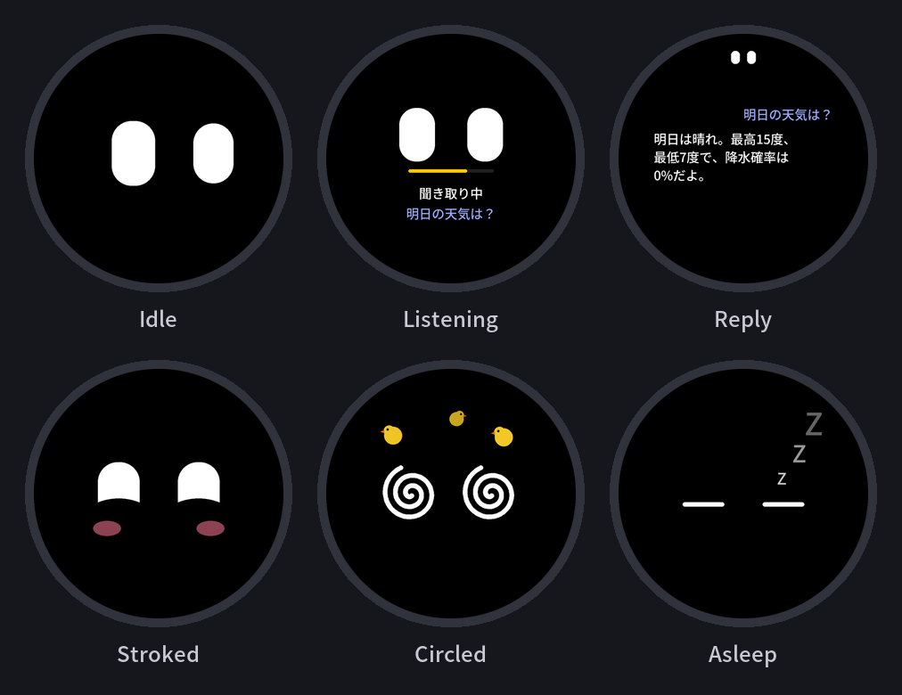

<div align="center">

<h1>m5-stopwatch</h1>
<p>Talk to Claude Code from the M5Stack StopWatch.</p>
  <p>
    
    
    
    
    
  </p>
  <p>
    
  </p>
  <p><sub>Illustration generated from the firmware's shapes and timings (<code>docs/images/make_demo_gif.py</code>).</sub></p>

</div>

A voice chat avatar for the M5Stack StopWatch. The round screen shows two white eyes with expressions. Hold the yellow key and speak: the audio streams to a relay on your Mac, which transcribes it with mlx-whisper and passes it to a resident Claude Code session signed in with your own account. The reply is typed out on the watch.

## How it works

```
 StopWatch (ota_1: voice app)                    Mac
+----------------------------+   HTTP / Wi-Fi   +-------------------------------+
| hold yellow key: record    | ---------------> | relay/relay.py                |
| 16 kHz audio, streamed     |   or BLE         |  mlx-whisper (speech-to-text) |
| reply typed on the screen  | <--------------- |  claude -p (stream-json)      |
+----------------------------+                  +-------------------------------+
 ota_0: stock launcher menu with an entry that boots the voice app
```

The watch uses HTTP over Wi-Fi and falls back to BLE when Wi-Fi is not available ([BLE protocol](docs/spec/ble-protocol.md)).

## Requirements

- M5Stack StopWatch
- A Mac with Apple Silicon (mlx-whisper)
- [Claude Code](https://code.claude.com/docs) installed and signed in with your own account
- [PlatformIO](https://platformio.org/) (`pio`) and [uv](https://docs.astral.sh/uv/)

## Quick start

Run the commands from the repository root.

1. Copy the settings and fill in `RELAY_TOKEN`, `WIFI_SSID`, `WIFI_PASS` and `RELAY_URL` (the Mac's address, port 8765):

   ```sh
   cp .env.example .env
   python3 -c "import secrets; print(secrets.token_urlsafe(24))"   # a value for RELAY_TOKEN
   ```

2. Download the font and convert it (it is not included):

   ```sh
   mkdir -p firmware/fonts
   curl -L -o firmware/fonts/NotoSansJP-Medium.otf \
     https://github.com/notofonts/noto-cjk/raw/main/Sans/SubsetOTF/JP/NotoSansJP-Medium.otf
   uv run --with freetype-py python firmware/tools/make_font.py
   ```

3. Build and flash the launcher menu into `ota_0`:

   ```sh
   pio run -d menu -t upload --upload-port <PORT>
   ```

4. Build the voice app and write it to `ota_1` at `0x510000` ([partitions](docs/spec/firmware.md#partitions)):

   ```sh
   pio run -d firmware
   uvx esptool --chip esp32s3 --port <PORT> write-flash 0x510000 firmware/.pio/build/m5stopwatch/firmware.bin
   ```

5. Start the relay on the Mac:

   ```sh
   cd relay
   uv run python relay.py
   ```

   For BLE, macOS asks for the Bluetooth permission for the app that started the relay (Terminal, iTerm2 and so on) on the first run. Allow it, or turn it on in System Settings > Privacy & Security > Bluetooth.

6. On the watch, open the entry named `Avatar` in the launcher (`AVATAR_NAME` in `.env`).

`<PORT>` is the watch's USB serial port, for example `/dev/cu.usbmodem1101`. Settings and details: [relay](docs/spec/relay.md), [firmware](docs/spec/firmware.md), [UI](docs/spec/ui.md).

## Controls

| Input | Action |
|---|---|
| Yellow key, hold | Talk. Release to send. |
| Yellow key, tap | Show or hide the conversation history |
| Blue key, tap | New session (clears the history) |
| Blue key, hold | Back to the launcher menu |
| Power key, click | Show these key tips on the screen |
| Drag on the history | Scroll; a tap closes it |
| Touch the eyes | The eyes follow the finger |
| Stroke the top / draw circles / shake | Smile / dizzy / angry |

The full list of states, expressions and timings is in [docs/spec/ui.md](docs/spec/ui.md).

## Screens

<p align="center">
  
</p>
<p align="center"><sub>Illustration generated from the firmware's shapes and numbers (<code>docs/images/make_screens.py</code>).</sub></p>

## Notes

- Each user runs the unmodified `claude` CLI signed in with their own Claude account. Check that your use fits Anthropic's terms: [Legal and compliance](https://code.claude.com/docs/en/legal-and-compliance). This is not legal advice.
- `CLAUDE_PERMISSION_MODE=bypassPermissions` runs every tool without asking. Anyone who knows `RELAY_TOKEN` can then run commands on the Mac. The default, `default`, refuses tools that need a confirmation.
- The text on the watch is Japanese, and speech recognition is set to Japanese.

## License

- `menu/` is the [M5StopWatch-UserDemo](https://github.com/m5stack/M5StopWatch-UserDemo) launcher by M5Stack, under the MIT License (`menu/LICENSE`). The changes are listed in [menu/README.md](menu/README.md).
- Noto Sans JP is licensed under the SIL Open Font License 1.1. It is not included in this repository; it is downloaded and converted during setup.
- Everything else: MIT License (`LICENSE`).
